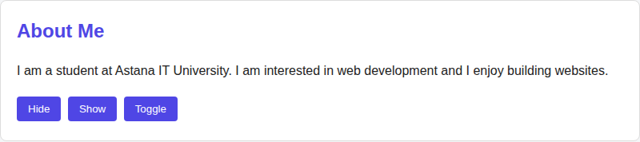
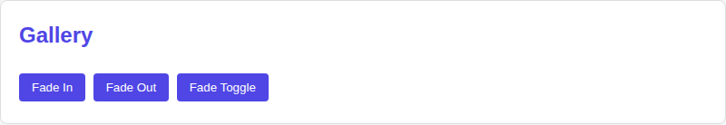
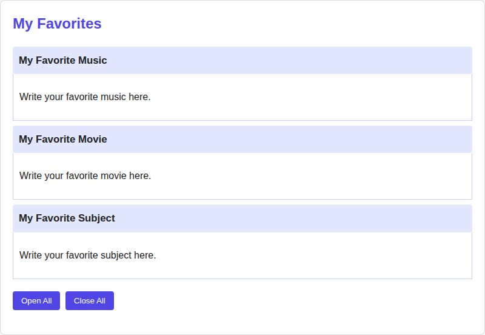
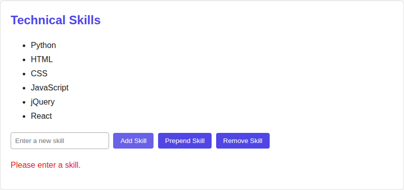
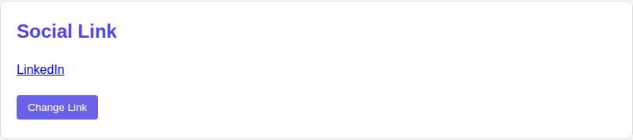
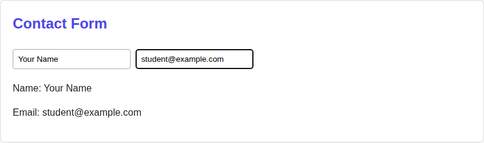
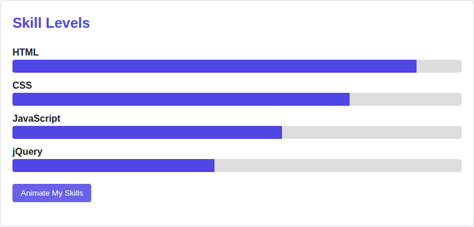

# Assignment 6. jQuery (Selectors, Effects, Animations)

**Name:** Your Name
**Group:** Your Group

**GitHub repository:** link
**GitHub Pages:** https://username.github.io/repository/

---

## Part 1. Getting Started with jQuery

### Task 0. Setup
- Include jQuery from a CDN.
- Write a `$(document).ready(function() { ... })` function.
- Test by printing "jQuery is ready!" in the console.

### Task 1. Selectors & CSS
- Display your name, a personal headline, and a short introduction.
- Include a profile section with a title such as "Welcome to My Portfolio."
- Use tag, ID, and class selectors to select different HTML elements.
- Dynamically update your greeting or headline using `.text()` or `.html()`.
- Use `.css()` to change the styling of selected elements.
- Add buttons to switch between light and dark themes.

## Part 2. jQuery Effects

### Task 2. Visibility Methods
- Create an "About Me" section.
- Add a short biography and a current status message, such as "Currently learning jQuery!"
- Include a few fun facts about yourself, your interests, or your goals.
- Add three buttons: Hide, Show, and Toggle.
- Use the buttons to control the visibility of your status message or fun facts.

### Task 3. Fade Methods
- Display at least two images.
- Use `.fadeIn()`, `.fadeOut()`, `.fadeToggle()` effects to control the visibility of gallery images.

### Task 4. Slide Methods
- Create at least three clickable headings.
- Place related information inside a collapsible panel beneath each heading.
- Use `.slideUp()`, `.slideDown()`, `.slideToggle()` to make the interaction smooth.

## Part 3. DOM Manipulation with jQuery

### Task 5. Add & Remove Elements
- Display an initial list containing at least four technical skills.
- Add a text input where visitors can enter a new skill.
- Create three buttons: "Add Skill," "Prepend Skill," and "Remove Skill."
- Use `.append()`, `.prepend()`, `.remove()`.
- Prevent empty skills from being added.

### Task 6. Modifying Attributes
- Add a social media link.
- Create a button that dynamically changes the link's destination using `.attr()`.

### Task 7. Form Interaction
- Create a form with inputs for Name and Email.
- When the user types, display their input live below the form using `.val()` and `.text()`.

## Part 4. Animations

### Task 8. Basic Animation
- Extend Task 5 by creating a visual representation of at least three technical skills using skill bars.
- Add an "Animate My Skills" button.
- Initially, the skill bars have zero width.
- When the button is clicked, use `.animate()` to increase the width of each skill bar.
- Use different target widths to represent different skill levels.
- When the button is clicked again, animate the skill bars back to zero width.

---

## Summary of Work Process
I connected jQuery from a CDN and wrapped all code in `$(document).ready()`. Then I built the page section by section, one section per task: first selectors and themes, then show/hide, fade and slide effects, then adding and removing list items, changing a link with `.attr()`, the live form output, and finally the animated skill bars. After each task I tested it in the browser and took a screenshot.
